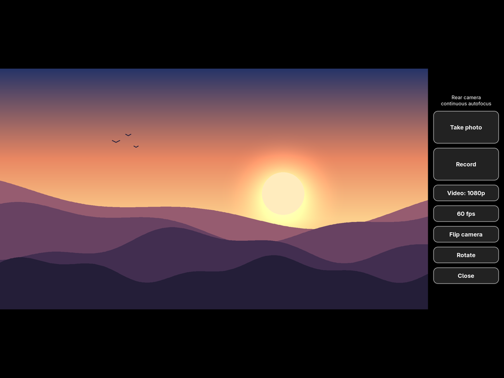

# Ocellus

A camera app for Linux phones and tablets, built on libcamera and GStreamer.
An ocellus is the small, simple eye that insects have next to their compound
eyes.

- Full-screen viewfinder with the controls in a side panel, sized for
  fingers.
- Photos are saved as JPEG to `~/Pictures`.
- Videos are saved as MP4 to `~/Videos`, H.264 or H.265 with AAC sound from
  the microphone. Recording uses the hardware encoder where there is one,
  and you can pick the video quality and frame rate.
- Continuous autofocus on cameras that have a focus lens.
- Flip between the cameras. Rotate the picture for each camera; the
  rotation is saved in the photos (EXIF) and videos (MP4).
- Keyboard keys, and signals for scripts.



The viewfinder in the screenshot shows a drawing, put in place of the
camera picture.

## Devices

The app takes its cameras from libcamera. On a device it knows (the `TUNED`
table at the top of `ocellus`), each camera gets the photo size and video
modes that were measured on that device. On any other device it offers
1080p, 720p and 480p at 30 fps, with whatever H.264 encoder GStreamer has
(`v4l2h264enc`, `openh264enc` or `x264enc`).

### Samsung Galaxy Tab S3 (SM-T820)

Tested on postmarketOS edge with the mainline kernel and libcamera from
[gts3lwifi-mainline](https://github.com/jaydens-tasty-slop/gts3lwifi-mainline)
(branch `otg-camera-cover`): the camera drivers, the Venus encoder fixes,
and libcamera with autofocus and S5K5E3 support. libcamera runs the simple
pipeline with the GPU software ISP, and Venus encodes the video.

| Camera | Photo | Video modes (fps) |
|---|---|---|
| Rear, Sony IMX258, autofocus | 3840x2160 | 4K H.265 (24), 1080p (30, 60), 720p (30, 60), 576p (30, 60, 120) |
| Front, Samsung S5K5E3 | 2568x1932 | 1080p (30), 864p (30, 60), 384p (30, 60, 120) |

Measured in the Plasma session with the viewfinder on and sound, from the
frame timestamps of 8 s recordings (after the first second):

| Camera | Mode | fps measured |
|---|---|---|
| Rear | 4K | 24.0 |
| Rear | 1080p | 30.0; 59.6 to 60.0 |
| Rear | 720p | 59.6 |
| Rear | 576p | 59.6; 119.3 to 120.0 |
| Front | 1080p | 29.9 |
| Front | 864p | 59.8 to 59.9 |
| Front | 384p | 59.8 to 60.7; 119.6 to 120.1 |

The 30 fps modes missing from the table weren't measured.

## Install

You need a Wayland desktop. On postmarketOS or Alpine:

```
apk add python3 py3-gobject3 gtk+3.0 gst-plugins-base gst-plugins-good \
	gst-plugins-bad libcamera-gstreamer pulseaudio-utils v4l-utils make
make install
```

`make install` puts `ocellus` in `/usr/local/bin` and the menu entry in
`/usr/local/share/applications`; set `PREFIX` or `DESTDIR` to change that.
You can also run `./ocellus` from the source directory.

The packages provide:

- `gst-plugins-bad`: the `gtkwaylandsink` viewfinder, the H.264 and H.265
  parsers, the JPEG muxer and the `fdkaacenc` AAC encoder;
- `gst-plugins-good`: the V4L2 encoders, MP4, JPEG and PulseAudio;
- `pulseaudio-utils`: `pactl`, which picks a microphone instead of a
  monitor source;
- `v4l-utils`: `v4l2-ctl`, for frame rates above 30 on a tuned device.

## Use

| Button | Key | |
|---|---|---|
| Take photo | Space, Enter | photo from the viewfinder |
| Record | V | start and stop a video |
| Video: ... | Q | next video quality |
| ... fps | S | next frame rate for that quality |
| Flip camera | F | next camera |
| Rotate | R | turn the picture a quarter turn clockwise |
| Close | Esc | close, after saving a video in progress |

From a script: `kill -USR1 <pid>` takes a photo, `kill -USR2 <pid>` starts
and stops a video, and `kill -TERM <pid>` closes the app.

Settings are kept in `~/.config/ocellus/`: the last camera, the quality per
camera, the frame rate and the rotation per camera. Messages go to stderr;
from the menu, they end up in the journal.

## Rotation

The default rotation of each camera is libcamera's `Rotation` property,
which comes from the camera's device tree `rotation`. That value describes
how the sensor is mounted relative to the device in its normal orientation.
Rotate overrides it for each camera.

The app doesn't follow the accelerometer yet. When you turn the device, the
picture doesn't turn with it.

## Adding a device

Run the app once from a terminal. It prints each camera's libcamera model
name and the device tree compatible it matched (if any). Then add a `TUNED`
entry for the compatible:

- `cameras`: one entry per sensor model.
  - `af`: the camera has autofocus.
  - `photo`: the viewfinder and photo size.
  - `modes`: the video modes as (label, width, height, `h264` or `h265`,
    frame rates).
- `vblank`: libcamera can't set the frame rate on this pipeline (no
  `FrameDurationLimits`). The app sets the frame rate itself: once the
  stream runs, it shortens the sensor's vertical blanking with `v4l2-ctl`.
- `dmabuf`: the V4L2 encoder imports the camera's RGBA buffers as they are,
  with no copy or conversion.

Measure each mode, for example with `ffprobe` on the frame timestamps, and
keep only the frame rates the sensor mode and the encoder really reach.
`OCELLUS_GENERIC=1 ocellus` shows what a device gets without its `TUNED`
entry.

## Known issues

- On the Tab S3, the microphone sometimes starts 5 s late (2 of 20 test
  recordings at 120 fps). The kernel's q6asm driver waits out a 5 s
  timeout when PipeWire prepares the capture a second time. The video
  keeps running, but drops frames until the sound starts. A kernel fix is
  being tested.
- On the Tab S3, 4K is H.265 at 24 fps only. Venus encodes 4K at about
  29.8 fps, and it refuses 25.
- A photo is a viewfinder frame, so the rear camera's photos are 3840x2160,
  not the sensor's full 13 MP.
- While recording, the viewfinder runs at 15 fps.

## License

CC0-1.0: Ocellus is dedicated to the public domain, see `LICENSE`.
